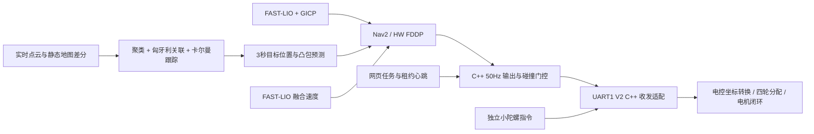

# 四轮全向底盘：HW FDDP 与动态障碍预测

本分支保留 FAST-LIO、关键帧检索/GICP、Nav2 任务接口、网页选点和租约接口。
全局规划使用 `hw_omni_controller::Planner`，复用 HW 原始空间 A*、LOS 参考路径、
引导走廊、Kino A*、MINCO 和弧长域速度剖面；局部控制使用 HW FDDP 和本车整车 XY 响应模型。
执行侧复用 HW 的 RouteTracker、无进展检测、物理卡住检测、倒车和危险区恢复状态机、极坐标安全点搜索。
Kino/MINCO 的航向表示平移切线方向，不命令雷达或底盘转向。平地适配不启用轮腿台阶、助跑和地形模式；
FAST-LIO 与独立小陀螺接口保持原设计，四轮逆运动学由电控完成。细节见 [规划与脱困适配](../validation/hw-planning-recovery.md)。

## 数据链



## 实现语言

FAST-LIO、GICP 配准、FDDP MPC、动态障碍检测/关联/卡尔曼跟踪/预测，以及 50 Hz 速度输出使用 C++。
新增 `obstacle_predictor` 和 `command_relay` 均由 `hw_omni_controller` 包构建为原生节点。
网页前端使用 JavaScript，对外 HTTP/WebSocket 与点云显示服务使用 C++ Drogon，详见 [网页架构](网页架构.md)。
生产任务监管、配置/启动、定位调度和关键帧索引由 C++ runtime 执行；Python 保留历史兼容与离线回归。任务层只发布租约心跳和状态，
不计算或转发运动速度。原 Python 障碍预测节点已经移除，避免同时运行两套实现。UART1 V2 收发适配同样使用 C++。

## 预留电控接口

以下是导航所需的 ROS 上下层契约。速度预测已切换到 FAST-LIO，不再依赖轮速反馈；
硬件授权独立接入，见 [FAST-LIO 速度预测](FASTLIO速度预测.md)。

| 方向 | Topic / 消息 | 含义 |
|---|---|---|
| C++ 输出节点 → 适配器 | `/hw/nav_command` / `NavCommand` | 有时间戳、租约、序号的 XY 平移目标，单位 m/s |
| 网页任务层 → C++ 输出节点 | `/hw/navigation_session` / `NavigationSession` | 任务授权与租约心跳，含硬件控制代次，不含速度 |
| 独立控制 → 适配器 | `/hw/spin_command` / `SpinCommand` | 独立旋转目标，单位 rad/s |
| FAST-LIO → 中心桥接 | `/navcar/state_estimation` → `/navcar/odom` | 融合线/角速度、采样时间、协方差与控制参考点补偿 |
| 硬件模式适配器 → 上位机 | `/hw/control_authority` / `ControlAuthority` | 拨杆授权、采样时间、序号和接管代次，不含速度 |

坐标为 `navcar_center`：原点在车体中心 yaw 轴，XY 方向随雷达，X 前、Y 左、Z 上。
运动速度来自 FAST-LIO 的雷达/IMU 融合状态，保留雷达帧结束时间戳，并按 IMU 到参考点的偏移补偿速度与协方差。
MPC 使用 LIO 的雷达角速度预测雷达方向，不使用底盘小陀螺转速或 UART 的惯导启动角。
地图姿态与速度采样时间不同时，按 LIO 角速度对齐采样姿态后再转换速度。

授权消息只负责拨杆/底盘模式。`authority_epoch` 在切换、人工接管和断连重建时递增，必须来自真实模式观测。
平移和旋转各有自己的命令有效期，更新一路不能给另一路续期。

UART1 V2 已由 C++ 8081 服务接入，见 [Navcar V2 接入](NavcarV2接入.md)。下发顺序仍是
`vy,vx,rot,yaw_angle`，但平移直接为 m/s，不再乘十；rot 逆时针为正。
状态帧前三项是底盘系轮速反解速度，第四项是云台相对启动方向的惯导角。
原始反馈发布到 `/hw/navcar/feedback`，与目标分别存储；NaN 表示轮速或惯导无效。
该协议不回传拨杆控制模式；需通过真实接口提供独立授权。预测已改用 LIO，故不再需要通过轮速、MCU 时间或云台相对角生成 `/hw/chassis_feedback`。
V2 的 `/api/spin` 与 `/hw/spin_command` 不刷新平移命令有效期，也不因平移心跳关闭旋转。
旧 V1 模式仅作显式兼容，原始目标回显不用于导航。

LIO 速度缺失、超过 150 ms、出现无效值或不确定度过大时停车等待；没有独立拨杆授权也不输出运动。
拨杆撤权或接管代次变化会取消目标和自动续行。
重新授权不会自动恢复旧目标。

## 整车预测模型

每轴使用一阶速度响应，`v_next = exp(-dt/tau) * v + (1-exp(-dt/tau)) * target`。
位置使用该模型的解析积分，XY 通过雷达方向转换到 map 系。
控制周期 50 ms，预测 40 步共 2 s。FAST-LIO 融合速度作为每轮优化初值；目标合速度上限
0.5 m/s，目标加速度 0.3 m/s²，目标 jerk 1 m/s³。紧急停止可以越过舒适性限制。
加速度/jerk 每轴使用向量上限的 1/sqrt(2)，合速度另作完整轨迹硬验收。

`navigation.mpc.tau_x_s/tau_y_s` 的 0.30 s 是初始假设，不是实测辨识结果。
接通后录制采样时间、实际速度、实际发送目标、旋转速度和云台相对角，分别检查
前后、侧移、斜移、制动和不同小陀螺转速下的响应。若存在明显纯延迟、打滑或
旋转耦合，应扩展模型；当前模型没有声称已经辨识这些效应。
上层只需要整车速度/加速度可执行范围，不求解单轮转速。

## 障碍预测与执行

点云在采样时刻变换到 map，静态地图 KD-tree 差分后做高度/距离过滤和聚类。
检测采用凸包保留形状；跨帧做匈牙利关联、恒速卡尔曼估计。确认目标按衰减速度
外推，未确认目标作为静态占据保留在全部未来时刻；短时遮挡保留预测并扩张形状。
预测发布 3 s，间隔 0.1 s，额外覆盖传输/处理年龄。

MPC 按 `now - observation_stamp + k*0.05` 插值障碍位置。不能直接拿第 k 张预测
当第 k 步，因为预测与控制步长不同。缺失、无效、超过 300 ms 或时域耗尽的预测
会阻止运动；有效的空列表表示观测正常且没有动态目标。
静态/当前障碍仍使用 Nav2 代价地图，未知格不可通行。优化后对整条轨迹做空间和
时间细分碰撞验收，包括静止车辆被运动目标穿越的情况。

诊断：`/hw/mpc/status`、`/hw/mpc/prediction`、`/hw/obstacles/status`、
`/hw/predicted_obstacles`、`/hw/command/status`。现有网页继续显示路线、定位和失败原因。

Nav2 的 `/navcar/cmd_vel_auto` 使用 `TwistStamped`，保留控制器原始时间戳。
C++ 输出节点独立检查任务心跳、实测反馈、定位、预测和局部地图的新鲜度，检查目标及实际速度的刹停通路后
才转发带租约的指令；接管或反馈异常后不能复用此前缓存的速度。网页或节点停止时，命令失效和下位机看门狗继续生效。
定位额外发布 `/hw/localization/state` 类型化消息给 C++ 节点，原 JSON 状态继续供网页显示。

## 验证范围

原生 C++ 测试不依赖 ROS：

```bash
g++ -O2 -std=c++20 -I /usr/include/eigen3 \
  -I hw_omni_controller/include -I hw_omni_controller/vendor \
  hw_omni_controller/test/test_mpc.cpp -o /tmp/hw_omni_test
/tmp/hw_omni_test
g++ -O2 -std=c++20 -I /usr/include/eigen3 -I hw_omni_controller/include \
  hw_omni_controller/test/test_runtime.cpp -o /tmp/hw_runtime_test
/tmp/hw_runtime_test
python3 -m unittest discover -s tests -v
python3 -m unittest discover -s web_panel -p 'test*.py' -q
```

构建与验收可在 `validation/Dockerfile` 对应 ROS Jazzy 环境运行，原生回归也可单独执行。
`validation/ros_integration.py` 显式发布合成 FAST-LIO 状态与独立拨杆授权，错误的轮速/旧 ChassisFeedback 不影响预测。合成模型测试不代表实车动力学、动态人群和狭窄通道已经验收。
