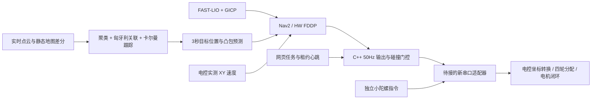

# 四轮全向底盘：HW FDDP 与动态障碍预测

本分支保留 FAST-LIO、关键帧检索/GICP、Nav2 NavFn 全局规划、网页选点和租约接口。
局部控制由 MPPI 改为 `hw_omni_controller::Controller`。直接复用 HW 的 FDDP
求解器，使用本车的整车 XY 速度响应模型。未引入 small_glim、轮腿 LPV 参数、
MINCO/动力学 A* 或台阶执行；四轮逆运动学由电控完成。

## 数据链



## 实现语言

FAST-LIO、GICP 配准、FDDP MPC、动态障碍检测/关联/卡尔曼跟踪/预测，以及 50 Hz 速度输出使用 C++。
新增 `obstacle_predictor` 和 `command_relay` 均由 `hw_omni_controller` 包构建为原生节点。
网页前端使用 JavaScript，对外 HTTP/WebSocket 与点云显示服务使用 C++ Drogon，详见 [网页架构](网页架构.md)。
Python 保留内部任务监管、配置/启动、定位调度、地图关键帧索引及离线回归；任务层只发布租约心跳和状态，
不计算或转发运动速度。原 Python 障碍预测节点已经移除，避免同时运行两套实现。后续新串口适配器优先使用 C++。

## 预留电控接口

以下是 ROS 上下层契约，不是已确定的 MCU 字节协议。协议版本、包头、字段编码、
CRC、时钟同步和重连规则仍待电控确定。当前没有新增 UART 报文编解码器。

| 方向 | Topic / 消息 | 含义 |
|---|---|---|
| C++ 输出节点 → 适配器 | `/hw/nav_command` / `NavCommand` | 有时间戳、租约、序号的 XY 平移目标，单位 m/s |
| 网页任务层 → C++ 输出节点 | `/hw/navigation_session` / `NavigationSession` | 任务授权与租约心跳，含硬件控制代次，不含速度 |
| 独立控制 → 适配器 | `/hw/spin_command` / `SpinCommand` | 独立旋转目标，单位 rad/s |
| 适配器 → 上位机 | `/hw/chassis_feedback` / `ChassisFeedback` | 实际 vx、vy、底盘角速度、云台相对角，外加采样时间、序号、控制授权和接管代次 |

坐标为 `navcar_center`：原点在车体中心 yaw 轴，XY 方向随雷达，X 前、Y 左、Z 上。
反馈速度是这个参考点的实际平移速度，不是偏心光心的速度。云台相对角定义为
“雷达/云台航向减底盘航向”，逆时针为正，单位 rad；必须计入固定安装角。
底盘角速度与雷达角速度分开。MPC 使用 FAST-LIO 的雷达角速度预测雷达方向，
不会把底盘小陀螺转速直接积分成雷达方向。
反馈频率高于雷达 TF 发布频率时，使用最近雷达姿态和实测雷达角速度补偿到反馈采样时刻，
并对位置做短时速度外推；原始姿态/里程计超过 150 ms 仍会停车，不用接收时间给旧状态续期。

四个实测量应同包、同一采样时刻，建议 50 Hz。适配器将采样时刻转换到 ROS 时钟，
不能用接收时刻掩盖旧数据。`authority_epoch` 在拨杆切换、人工接管、断连重建时递增；
新代次可重置序号。适配器必须验证命令有效期、租约、序号和硬件授权。
平移和旋转各有自己的命令有效期，更新一路不能给另一路续期。平移指令的
`twist.angular.z=0` 只说明本通道不控制旋转，不应关闭独立小陀螺。

旧 `navcar_uart1_v1` 的四浮点 STATE 是目标回显，不可转换为 `ChassisFeedback`。
旧 8081 服务仍用于原协议回归，其小陀螺操作会撤销导航租约；新协议的独立旋转
必须由新适配器实现。预留接口并不代表旧固件已经支持新能力。
新适配器需兼容现有 8081 的 `/api/state`、`/api/navigation/acquire` 和
`/api/navigation/release` 租约端点，或在接线时同步替换网页的这层适配。
原有倍率只属于旧串口后端，新后端按 SI 单位接收，不能再重复乘十。

没有新协议实测反馈，网页显示等待反馈，控制器不输出运动。反馈超过 150 ms、
无效值、拨杆拒绝控制或接管代次变化均使输出失效。接管会取消目标和自动续行。
重新授权不会自动恢复旧目标。

## 整车预测模型

每轴使用一阶速度响应，`v_next = exp(-dt/tau) * v + (1-exp(-dt/tau)) * target`。
位置使用该模型的解析积分，XY 通过雷达方向转换到 map 系。
控制周期 50 ms，预测 40 步共 2 s。实际速度作为每轮优化初值；目标合速度上限
0.5 m/s，目标加速度 0.3 m/s²，目标 jerk 1 m/s³。紧急停止可以越过舒适性限制。
加速度/jerk 每轴使用向量上限的 1/sqrt(2)，合速度另作完整轨迹硬验收。

`navigation.mpc.tau_x_s/tau_y_s` 的 0.30 s 是初始假设，不是实测辨识结果。
接通后录制采样时间、实际速度、实际发送目标、旋转速度和云台相对角，分别检查
前后、侧移、斜移、制动和不同小陀螺转速下的响应。若存在明显纯延迟、打滑或
旋转耦合，应扩展模型；当前模型没有声称已经辨识这些效应。
上层只需要整车速度/加速度可执行范围，不求解单轮转速。

## 障碍预测与执行

点云在采样时刻变换到 map，静态地图 KD-tree 差分后做高度/距离过滤和聚类。
检测采用凸包保留形状；跨帧做匈牙利关联、恒速卡尔曼估计。确认目标按衰减速度
外推，未确认目标作为静态占据保留在全部未来时刻；短时遮挡保留预测并扩张形状。
预测发布 3 s，间隔 0.1 s，额外覆盖传输/处理年龄。

MPC 按 `now - observation_stamp + k*0.05` 插值障碍位置。不能直接拿第 k 张预测
当第 k 步，因为预测与控制步长不同。缺失、无效、超过 300 ms 或时域耗尽的预测
会阻止运动；有效的空列表表示观测正常且没有动态目标。
静态/当前障碍仍使用 Nav2 代价地图，未知格不可通行。优化后对整条轨迹做空间和
时间细分碰撞验收，包括静止车辆被运动目标穿越的情况。

诊断：`/hw/mpc/status`、`/hw/mpc/prediction`、`/hw/obstacles/status`、
`/hw/predicted_obstacles`、`/hw/command/status`。现有网页继续显示路线、定位和失败原因。

Nav2 的 `/navcar/cmd_vel_auto` 使用 `TwistStamped`，保留控制器原始时间戳。
C++ 输出节点独立检查任务心跳、实测反馈、定位、预测和局部地图的新鲜度，检查目标及实际速度的刹停通路后
才转发带租约的指令；接管或反馈异常后不能复用此前缓存的速度。网页或节点停止时，命令失效和下位机看门狗继续生效。
定位额外发布 `/hw/localization/state` 类型化消息给 C++ 节点，原 JSON 状态继续供网页显示。

## 验证范围

原生 C++ 测试不依赖 ROS：

```bash
g++ -O2 -std=c++20 -I /usr/include/eigen3 \
  -I hw_omni_controller/include -I hw_omni_controller/vendor \
  hw_omni_controller/test/test_mpc.cpp -o /tmp/hw_omni_test
/tmp/hw_omni_test
g++ -O2 -std=c++20 -I /usr/include/eigen3 -I hw_omni_controller/include \
  hw_omni_controller/test/test_runtime.cpp -o /tmp/hw_runtime_test
/tmp/hw_runtime_test
python3 -m unittest discover -s tests -v
python3 -m unittest discover -s web_panel -p 'test*.py' -q
```

本次开发环境没有 ROS；原生模型/求解器与 Python 回归可以执行，ROS 插件、
消息生成及完整 Jazzy 联调需在 `validation/Dockerfile` 对应环境运行。
`validation/ros_integration.py` 显式发布模拟电机实际速度；它不会把 V1 目标回显
当测量。合成模型测试不代表实车动力学、动态人群和狭窄通道已经验收。
