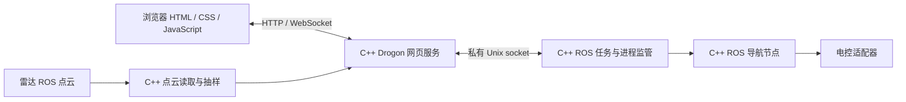

# JavaScript 前端与 C++ 网页服务

前端保留原生 HTML/CSS/JavaScript 和现有建图、地图选点、路径预览、导航交互。
`shaoshao_web` 是 Drogon 实现的 C++ HTTP/WebSocket 服务，默认对外端口 8080。
导航控制、障碍预测和 50 Hz 指令输出仍由独立 C++ ROS 节点执行。



`shaoshao_hw_runtime` 提供 C++ 定位调度、地图索引、建图/导航进程监管、
Nav2 action 与生命周期适配，以及 8081 串口兼容服务。`hw_runtime preview` 启动
`hw_supervisor`，后者启动 C++ 网页子进程。Python 保留为测试、历史兼容实现和
可选的旧 ROS launch 文件；当前部署脚本的生产运行入口使用 C++。
新电控字节协议仍待确定，旧 UART V1 的目标回显不作为实际反馈。

## 数据传输

- 浏览器 API 路径保持 `/api/state`、`/api/cloud`、`/api/map`、`/api/map/image`、
  `/api/navigation/*`、`/api/mode`、`/api/mapping/filter` 等。
- 状态通过 WebSocket 推送，HTTP 查询保留为回退方式。只有服务声明支持 WebSocket 后
  前端才建立连接，旧演示服务可以继续使用 HTTP。
- 显示点云由 C++ 直接从 ROS 读取，最多 6000 点，约 5 Hz。向浏览器发送 float32
  二进制坐标，C++ 任务监督进程只接收少量点云状态元数据。无新数据、视角或画布尺寸变化时，
  前端跳过点云重绘。
- WebSocket 每个客户端只允许一个未确认批次；客户端完成解码后发送 ACK。
  慢客户端不会持续积压点云，3 秒不确认则断开，连接数最多 8。
- 控制请求继续使用 HTTP。任务服务连接中断或状态超过 1 秒，网页返回不可用；
  过期的排队控制请求不会稍后自动执行。网页推送不直接发送电机速度。

二进制点云格式：`SCPC` 四字节标记、uint32 小端 JSON 头长度、UTF-8 JSON 头，
然后是小端 float32 XYZ 数组。JSON 头包含 `sequence/frame/source/count`。
前端验证长度、点数、有限值及序号，成功处理后确认对应状态批次。

HTTP 使用 Bearer token。WebSocket 连接后的第一条消息为认证消息，未认证前不发送
状态或点云；token 不放入 WebSocket URL。地图图像只允许来自配置的地图根目录，
前端与图片之外不开放源码文件。私有 `web-supervisor.sock` 权限为 0600，允许操作固定，
不能执行任意命令或文件读取。

## 安装与启动

Ubuntu 24.04 的 Drogon 开发包还需要对应开发依赖供 CMake 查找：

```bash
sudo apt install libdrogon-dev libjsoncpp-dev libtrantor-dev uuid-dev zlib1g-dev \
  libbrotli-dev libhiredis-dev libpq-dev libmariadb-dev libsqlite3-dev libyaml-cpp-dev
bash deployment/bootstrap.sh
bash ~/ccc/shaoshao-hw-runtime/start_mapping.sh --idle
```

构建共八个 ROS 包。主网页 token 保存于运行目录 `web.token`，8081 token 保存于
`navcar_move.token`；启动终端输出对应访问地址。生产构建开启 ROS 点云订阅；不连接 ROS 的测试构建必须显式使用
`--fixture`，生产构建拒绝该模式。

## 验证

可在没有 ROS 的开发机编译并测试真正的 C++ HTTP/WebSocket 服务：

```bash
cmake -S shaoshao_web -B /tmp/shaoshao-web-build -DSHAOSHAO_WEB_ROS=OFF
cmake --build /tmp/shaoshao-web-build -j2
python3 validation/web_integration.py /tmp/shaoshao-web-build/shaoshao_web
node web_panel/validation/mobile_mapping_ui.cjs
node web_panel/validation/lidar_mapping_ui.cjs
node web_panel/validation/stream_ui.cjs
```

集成测试使用本地 Unix socket 和模拟任务状态，验证实际 HTTP 鉴权、命令转发、
地图范围、WebSocket 认证、二进制点云、ACK 和内部服务失联。
完整 C++ Jazzy 合成链路验证见 [验证记录](../validation/README.md)；真实 MID360 与底盘仍需上车验收。
