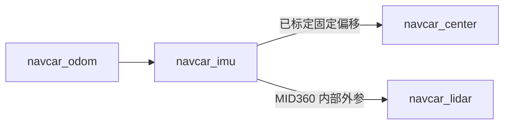

# 65 cm 通道：中心参考点与统一细图配置联调

本实现提供可在实车上验收的软件配置，尚未完成 ROS 2 Jazzy 全链运行或实车通行验证。
2026-10-21 最新测量为正八边形对边距 550 mm、通道宽 650 mm，替代此前 510 mm / 600 mm 的联调尺寸；文件名保留以兼容已有链接。
离线测试中，两侧墙完整保留的理想 65 cm 通道能留下中心路径，同一边距下 63 cm 和 60 cm 通道仍拒绝；
这只验证几何、栅格投影与参数，不是实际 Nav2 规划/跟随成功的证据。

## 当前测量与为什么能减少保守余量

- 含轮子和突出物的正八边形对边距 550 mm，外接半径约 297.658 mm，配置向上取整为 0.297658 m。
- 本次联调通道宽度为 650 mm。
- yaw 轴位于车体中心。雷达底面及 yaw 安装面离地 280 mm，点云原点离地 327 mm。
- 用户确认从 yaw 轴指向光心的偏心向量在雷达坐标中为 `[-14.18, 0] mm`。
- 用户此前确认原始点云能稳定看到约 30 cm 处两侧墙面；当前通道仍需验收处理后的近场扫描。

旧模型在 IMU 原点叠加车体半径、光心偏心长度和内部 IMU 平面偏移；按最新尺寸计算，名义碰撞直径约 71.5 cm。
现在可以依据实测偏心方向建立真实的轴心参考点，去掉原点选择引入的额外包络：

```text
IMU -> 光心 = [-11.00, -23.29, 44.12] mm
轴心 -> 光心 = [-14.18, 0] mm（平面向量）
IMU -> 轴心参考点 = [3.18, -23.29, 0] mm
```

`navcar_center` 的水平原点在真实 yaw 轴上，高度取 IMU 平面，坐标方向跟随雷达 IMU。
它不是实际底盘姿态，也不伪造底盘或关节反馈。圆形碰撞外形覆盖底盘任意朝向；
即使没有实际车身朝向反馈，也不会漏掉八边形顶点。



新的名义碰撞宽度为 `2 × (0.297658 + 0.020) = 0.635316 m`。
2 cm 边距没有减少，真实车体的最大外接直径约为 59.53 cm。65 cm 与模型宽度之差约 14.684 mm，每侧约 7.342 mm，
栅格、点云噪声和定位误差仍可能使实车规划拒绝；不能将这个计算值当成通行保证。
平边对墙时实际外形每侧 50 mm 的几何间隙，也不等于允许同样大的跟踪误差。

## 合并实车配置

在待机并停止 8080、8081 后备份原 `web_panel/robot.yaml`，合并以下字段，保留原串口、网络和安装角：

```yaml
robot:
  across_flats_m: 0.550
  circumscribed_radius_m: 0.297658
  lidar_bottom_height_m: 0.280
  lidar_height_m: 0.327
yaw:
  axis_xyz_m: [0.0, 0.0, 0.280]
  lidar_offset_radius_m: 0.01418
  lidar_offset_xy_m: [-0.01418, 0.0]
navigation:
  max_speed_mps: 0.5
  reference_point: yaw_axis
```

以下参数全局生效，无需模式开关。旧个人配置中的 `narrow_passage` 字段可删除，其值不再影响运行：

| 项目 | 统一配置 |
| --- | --- |
| 有效合成移速上限 | 0.5 m/s；Nav2、转发和8081共用 |
| 静态导出、二维投影、全局和局部栅格 | 0.01 m |
| LIO 内部匹配体素 | 保留 0.15 m |
| 局部窗口 | 2 × 2 m，10 Hz 更新 |
| 全局更新 / 发布 | 1 Hz / 1 Hz |
| LIO、扫描、AMCL和障碍层近距下限 | 0.20 m |
| LaserScan 原点 | 真实光学原点 `navcar_lidar` |
| 定位与控制参考点 | `navcar_center` |
| 定位输出门控 | AMCL 的 x/y 标准差均不超过 10 mm，方向门控仍保留 |
| 轨迹采样间距 / 预测时长 | 5 mm / 2 s |
| DWB 非致命障碍评分权重 | 0.001；致命/内切碰撞仍拒绝 |

AMCL 标准差门控只表示滤波器自身的不确定度估计，不证明现场绝对误差小于 1 cm。
未达到门控时先检查观测、初始位置和地图匹配，不通过放宽门控来宣称通行成功。
原始点云可见墙面的确认也不能替代处理后扫描验收：降低近距过滤后仍要检查自体点和漏检。
障碍层不把无返回扫描束当作清空射线，避免因近场过滤或遮挡把未知方向清成空地。

`navigation.max_speed_mps` 可配置更低速度，全局最高为 0.5 m/s，且仍受串口量程约束。
更改速度后必须重启两个服务；仅改生成文件不会持久生效。

## 更新、编译和新建小范围地图

按 [部署指南](../deployment/README.md) 备份、停止服务和合并实车配置，然后执行：

```bash
cd ~/ccc/shaoshao
git pull --ff-only
cp -a deployment/. ~/ccc/
bash ~/ccc/build_mapping.sh
```

此次修改了 C++ 支持的最小静态分辨率，需要重新编译。然后分别启动：

```bash
bash ~/ccc/start_move_web.sh
# 另一个终端
bash ~/ccc/start_mapping.sh
```

在 8080 开始建图，先只覆盖入口、过道及出口的几米范围，缓慢补足地面、两侧墙和出口观测后保存。
1 cm 二维地图在同样范围内格数是 5 cm 的 25 倍，静态体素数量也明显增加；
先用小地图评估 LIO 延迟与内存，不直接整场高精度建图。静态体素仍限 200 万、二维地图仍限 1600 万格。
静态确认仍要求多帧观测，细图中点过稀或未充分确认时会出现未知格；应补充观测，不将灰区填白。
导航期间关闭静态导出过滤，避免继续维护高精度导出体素。

旧 5 cm 地图不能仅修改 YAML 的 `resolution` 变成 1 cm 地图，也不能通过插值恢复丢失观测。
导航启动时会拒绝分辨率大于 1 cm 或缺少分辨率的地图。修改参考点不会改变保存地图的世界坐标，
已有 IMU 初始位置在载入时会转换为中心位置；新保存的位置携带参考偏移，避免重复转换。

## 按顺序验收

车辆先静止，只查看数据，不点击“前往目标”。在建图及导航对应阶段核对：

```bash
source /opt/ros/jazzy/setup.bash
source ~/ccc/mapping_install/setup.bash
ros2 param get /static_map_projector resolution         # 仅建图时存在，应为 0.01
ros2 param get /navigation_scan target_frame           # 导航时，应为 navcar_lidar
ros2 param get /navigation_scan range_min              # 应为 0.2
ros2 param get /global_costmap/global_costmap robot_base_frame # navcar_center
ros2 param get /global_costmap/global_costmap robot_radius     # 0.297658
ros2 param get /global_costmap/global_costmap footprint_padding # 0.02
ros2 param get /controller_server FollowPath.max_speed_xy      # 0.5
ros2 topic echo /global_costmap/costmap --once --field info
ros2 run tf2_ros tf2_echo navcar_imu navcar_center
ros2 run tf2_ros tf2_echo navcar_imu navcar_lidar
```

两个 `tf2_echo` 命令持续运行，用 Ctrl+C 结束后再执行下一条。
8081 的 `/api/state` 中 `navigation_max_speed_mps` 应为 0.5。
比较原始点云、`/cloud_registered_body`、`/navcar/scan` 和代价图：两侧墙必须稳定保留，
车上结构不能被错误标在通道中央；在真实侧墙附近放置物体时也应能标记，不能只看到无障碍状态。

先在开阔处验证前后左右、停止和手动接管，再停在入口预览出口目标，检查整条路径没有穿墙或进入未知格。
预览成功后从低速验证直行过道，逐步提高速度，最高 0.5 m/s；实测最大横向误差、实际最窄宽度、停止距离和重复通过结果。
若预览失败，保留地图、实际 `nav2.yaml`、`frames.yaml`、代价图及连续点云；
不要通过缩小 297.658 mm 实际包络、删除墙点、关闭碰撞检查或允许未知区域来制造可通行结果。

此实现保留圆形外形以覆盖所有底盘朝向。更窄通道若要利用八边形平边的 550 mm 宽度，
仍需实际底盘朝向反馈与完整多边形扫掠碰撞检查，不能仅改一个八边形 `footprint`。
